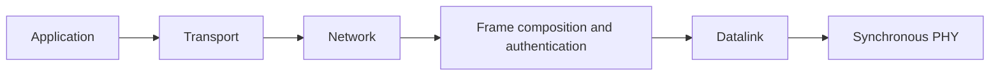

# Architecture

XGen Link is a standalone C11 protocol library. It owns wire encoding, link processing and reliable state. The production library builds its own protocol storage, queues, bitsets, byte encoding and CRC. The application owns the clock, execution context, PHY driver and trusted key establishment.

## Module Boundaries

| Module | Responsibility | Boundary |
| --- | --- | --- |
| API | Validate ABI/profile/capacities; construct instances; drive work | Public configuration and explicit timestamps |
| Transport | Exact peer ownership; reliable DATA; ACK; retry; optional out-of-order receive buffering | Typed logical packet views |
| Network | Route lookup, TLV composition, local authentication, forwarding | Logical packets above, complete frames below |
| Security | Installed directional nonce domains, signing and replay state | Versioned authentication input |
| Datalink | Incremental stream framing and synchronous PHY submission | Borrowed byte spans |
| Wire | One canonical frame parser, serializer and extension encoding | Bounded input and output spans |
| Protocol memory | Reserve resources by their protocol lifetime | Private storage and optional public allocator callbacks |

## Send and Receive Flow

Receive reverses the boundary direction: each PHY parser calls wire to validate a complete frame and produce a borrowed view. Datalink and network pass that view through; network verifies local authentication before transport changes peer state. The complete-frame CRC is computed once. Internal raw-frame entry points still validate their inputs before delivery.

Copied, authenticated and in-place sends share frame measurement and encoding rules, with datalink as the single PHY submission owner. Forwarding creates no local transport state but uses that same PHY exit. Reliable retransmission starts from an owned logical packet and traverses frame composition again, retaining its DATA number while obtaining a fresh security sequence.

## Ownership and Execution

One peer owns one exact `(remote_id, connection_id, session_epoch)` scope, including its window, wait-ACK records, RTT and receive order. Borrowed packet/frame views never outlive a synchronous call; retained payloads have a resource-class owner. Security state is separate from peer lifetime and survives transport RESET.

The instance owns one security context, borrowed by the layers. Each unique PHY descriptor owns one parser and RX cache; multiple routes sharing that descriptor do not reserve duplicates. A retained out-of-order frame keeps its storage while the application reports BUSY.

Calls on one instance are serialized by the caller. Callbacks cannot reenter or destroy that instance. The application provides the clock and schedules protocol work. Runtime operations use the fixed workspace reservations. See [Memory](resource-model.md) and [Platform](../guides/porting.md).

## Source and Build Boundaries

`include/xgl/` contains only the public SDK. Private headers live with their implementations under `src/api`, `wire`, `datalink`, `network`, `transport` and `security`. Cross-layer data and resource contracts live under `src/internal`. Private directories are neither installed nor exported to consumers.

Production exports one `xgl::xgl` target. `cmake/XglVersion.cmake` supplies the version to the library and standalone docs. `XglProfiles.cmake` resolves the profile and resource identity, `XglSources.cmake` selects the production translation units by capability, and `XglLibrary.cmake` assembles the library with its matching configuration header. `XglInstall.cmake` exports the SDK and `XglDevelopment.cmake` registers the selected development checks.

Protocol regression suites live under `test/unit/<layer>`, `test/integration`, and `test/property`. `test/smoke` contains the C11 fixtures, `test/interop` contains the cross-SDK Wire peers, and `test/contracts` groups build, SDK, CTest, and footprint checks. Test discovery preserves historical names and replay seeds.
